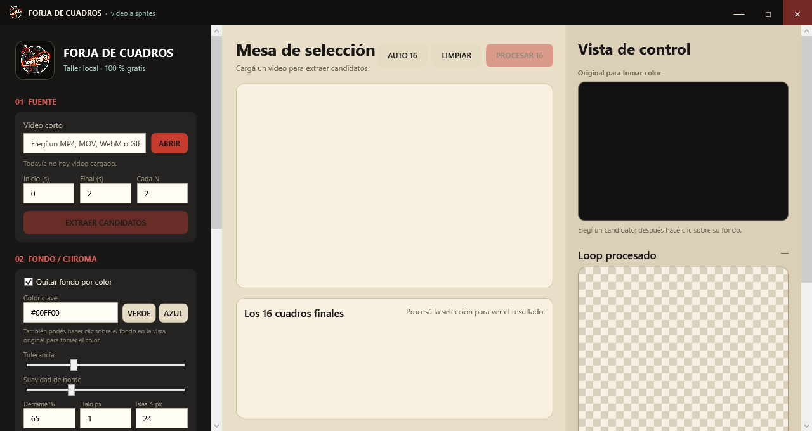

# Forja de Cuadros

Aplicación gratuita y local para convertir un video corto en una animación raster de 16 cuadros lista para revisar e integrar en Godot.



La herramienta prepara imágenes transparentes sobre chroma, recibe MP4, MOV, WebM o GIF, extrae fotogramas con FFmpeg y permite seleccionar, limpiar, alinear, auditar y exportar la animación. Forja procesa todo localmente; para generar el clip se abre el servicio externo que prefieras y la carga del archivo se hace de forma explícita.

> **English:** A free, local Windows tool that turns a short video into a reviewed 16-frame raster animation package for Godot. The UI is currently in Spanish.

## Qué resuelve

- Extrae candidatos de un tramo preciso del video.
- Distribuye automáticamente una selección inicial de 16 cuadros.
- Quita fondos verdes o azules con tolerancia, suavizado, despill, erosión de halo, limpieza de islas y corte alfa ajustable.
- Mantiene una escala común y registra raíz/suelo según el tipo de movimiento.
- Detecta cuadros vacíos, duplicados, recortes, deriva de altura/suelo/raíz y una mala costura del loop.
- Exporta PNG individuales, atlas 4×4 u horizontal, GIF, revisión HTML, metadata JSON y `SpriteFrames.tres`.
- Conserva cada exportación en una carpeta nueva: no pisa animaciones previas.
- Convierte localmente la transparencia de una imagen en fondo verde o azul y muestra lado a lado el original y el chroma preparado.
- Deja la ruta preparada lista para copiar o ubicar en su carpeta y ofrece accesos a generadores I2V aprobados sin guardar cuentas ni enviar archivos por su cuenta.

## Requisitos

- Windows 10 u 11, x64.
- [.NET 8 SDK](https://dotnet.microsoft.com/download/dotnet/8.0) para compilar. Una publicación dependiente del framework requiere además el .NET 8 Desktop Runtime.
- [FFmpeg](https://ffmpeg.org/) y `ffprobe` disponibles en `PATH`. En Windows también se detecta la instalación de WinGet:

```powershell
winget install --id Gyan.FFmpeg --exact
```

## Inicio rápido

```powershell
git clone https://github.com/ldebortoli/forja-de-cuadros.git
cd forja-de-cuadros
dotnet build ForjaDeCuadros.sln -c Release
dotnet run --project src\ForjaDeCuadros\ForjaDeCuadros.csproj -c Release
```

Para instalarla en el menú Inicio con su icono propio:

```powershell
powershell -NoProfile -ExecutionPolicy Bypass -File src\ForjaDeCuadros\install_forja.ps1
```

Usá `-SelfContained` para incluir el runtime de .NET en la instalación, o `-CodexApps` si querés instalarla en tu carpeta personal `Codex Apps`.

## Workflow recomendado

1. Generá el personaje donde prefieras y, si es posible, guardalo como PNG transparente.
2. En `00 GENERAR IMAGEN`, elegí el archivo: Forja prepara chroma verde automáticamente y completa la ruta del paso 01. Podés cambiarla a azul con un clic. Este paso es local y no consume créditos.
3. En `01 CONVERTIR A VIDEO`, copiá o localizá el PNG preparado, abrí un generador externo aprobado y pedí cámara fija, personaje completo y una sola acción de 2–4 segundos. Por ahora la lista incluye Grok Imagine.
4. En `02 VIDEO`, cargá el clip, definí inicio/final y extraé candidatos.
5. Elegí exactamente 16 cuadros; `AUTO 16` distribuye la selección sobre todo el tramo.
6. En `03 FONDO / CHROMA`, tomá el color del fondo. Si queda un contorno semitransparente, dejá activa `Limpiar halo con corte alfa`, subí **Corte alfa** hasta eliminarlo y compensá un borde dentado con un poco de **Suavizado del corte**. La vista sobre damero se actualiza mientras movés ambos controles.
7. Elegí el registro:
   - **Suelo + raíz fijos:** loops in-place.
   - **Suelo fijo, conservar avance:** locomoción a través del canvas.
   - **Cámara fija:** saltos, caídas o dash con movimiento vertical.
8. Procesá y revisá el GIF, los bordes, las huellas únicas y la costura `16 → 01`.
9. Exportá el paquete e integrá el atlas aprobado a la ruta declarada para Godot.

El corte alfa viene activo en `10 %` con `4 %` de suavizado. Forja lo aplica antes de calcular los límites y de nuevo después del escalado: la primera pasada evita que el halo altere la alineación y la segunda elimina transparencias débiles introducidas por el remuestreo. Los PNG originales nunca se modifican.

### Generar el clip con un servicio externo

El paso **01 CONVERTIR A VIDEO** no ejecuta modelos ni conecta cuentas. Conserva la ruta exacta del PNG preparado, permite copiarla o mostrarla en el Explorador y abre los servicios que el proyecto haya aprobado. La lista inicial contiene solamente **Grok Imagine**. Subí el archivo manualmente, descargá el resultado y cargalo en `02 VIDEO`.

Separar la generación evita atar Forja a una cuenta, cuota o modelo concreto. También permite comparar varios proveedores sobre la misma imagen canónica antes de invertir tiempo en la extracción. Revisá siempre identidad, anatomía, equipo rígido y uniformidad del chroma antes de convertir el clip en cuadros.

La [comparación de proveedores](docs/proveedores-i2v.md) distingue cupos recurrentes, pruebas únicas, marcas de agua y restricciones de uso. Solamente los servicios aprobados aparecen como botones dentro de la aplicación.

La auditoría automática encuentra problemas mecánicos, pero no reemplaza la revisión de anatomía, dirección de pies, ropa, pelo o equipo rígido.

## Desarrollo, tests y cobertura

Suite rápida y determinista:

```powershell
dotnet test ForjaDeCuadros.sln -c Release --no-restore
```

Cobertura con umbrales de regresión para el núcleo de procesamiento (líneas 78 %, ramas 48 % y métodos 72 %):

```powershell
dotnet test tests\ForjaDeCuadros.Tests\ForjaDeCuadros.Tests.csproj -c Release --no-restore /p:CollectCoverage=true
```

Autoprueba completa con FFmpeg (más lenta):

```powershell
dotnet build src\ForjaDeCuadros\ForjaDeCuadros.csproj -c Release
$report = Join-Path $PWD 'artifacts\self-test.json'
$process = Start-Process -FilePath 'src\ForjaDeCuadros\bin\Release\net8.0-windows\ForjaDeCuadros.exe' -ArgumentList @('--self-test', $report) -WindowStyle Hidden -Wait -PassThru
exit $process.ExitCode
```

Captura reproducible del panel de limpieza alfa:

```powershell
$capture = Join-Path $PWD 'artifacts\alpha-controls.png'
$process = Start-Process -FilePath 'src\ForjaDeCuadros\bin\Release\net8.0-windows\ForjaDeCuadros.exe' -ArgumentList @('--capture-alpha', $capture, '--capture-width', '1440', '--capture-height', '960') -WindowStyle Hidden -Wait -PassThru
exit $process.ExitCode
```

CI ejecuta build, tests y cobertura en cada push y pull request. La autoprueba con FFmpeg queda como workflow manual para cuidar los minutos gratuitos.

Coverlet mide líneas, ramas y métodos; no expone una métrica de *statements* separada, por lo que líneas es el control equivalente para sentencias ejecutables. La medición local actual es 84,84 % de líneas, 65,72 % de ramas y 78,37 % de métodos. Los conectores WPF generados por XAML se excluyen de forma explícita; no contienen lógica mantenida a mano.

## Privacidad y alcance

- La preparación de transparencia/chroma, la selección de cuadros y la exportación ocurren enteramente en tu PC.
- El flujo local no requiere cuentas, telemetría, API keys ni servicios en la nube.
- Forja no conecta cuentas ni sube imágenes o videos a terceros. Los botones de proveedores solamente abren su sitio web.
- El usuario decide qué archivo subir y queda sujeto a los términos y políticas del servicio externo elegido.
- Los logs de fallos, si existen, quedan en `%LOCALAPPDATA%\ForjaDeCuadros\Logs`.
- Los binarios, videos, exportaciones, logs y contenido del usuario están excluidos del repositorio.

## Licencia

[MIT](LICENSE). Podés usar, modificar y compartir la herramienta, incluso en proyectos comerciales.
